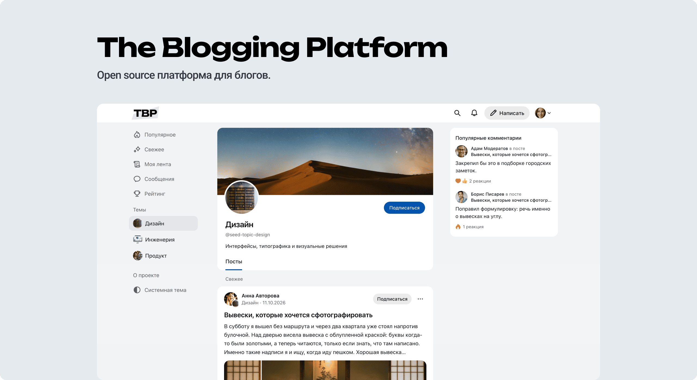

# The Blogging Platform v1.0

An open source blogging platform. People publish articles, read the feed, discuss posts, and keep profiles inside one shell: a header, navigation on the left, content in the center, and popular comments on the right.

See [CHANGELOG.md](CHANGELOG.md) for version history and maintenance rules.

See [Images and Cloudflare R2](docs/media-storage.md) to configure image compression
and S3-compatible storage from administration.



## Stack

The browser talks only to the gateway. Requests then go to the identity, content, discussion, messaging, notification, and media services. Each service has its own database, services exchange events, and files are stored separately.


| Layer    | Contents                                                                                             |
| -------- | ---------------------------------------------------------------------------------------------------- |
| Client   | React 19, TypeScript, Vite, Tailwind CSS 4, HeroUI, TanStack Query, Zustand, React Router, Editor.js |
| Services | Node.js 22, TypeScript, Fastify, Drizzle ORM, Zod                                                    |
| Data     | PostgreSQL 16, one database per service                                                              |
| Events   | NATS JetStream                                                                                       |
| Files    | MinIO                                                                                                |
| Sign-in  | Firebase Authentication; an emulator in local and dev                                                |
| Runtime  | pnpm, Docker Compose                                                                                 |


## Installation

You need Node.js 22, pnpm 9.15, and Docker with Compose v2. Run the commands from the repository root.

```bash
pnpm install
cp infra/env/local.env.example infra/env/local.env
pnpm local
```

`pnpm local` starts the services, databases, NATS, MinIO, the client, the Firebase Auth emulator, and Mailpit, then loads the small set of test data. Before starting, replace `AUTH_EMAIL_SECRET` with a stable random value of at least 32 characters (`openssl rand -hex 32`). Other existing `CHANGE_ME` placeholders remain supported in `local`.

The site opens at [http://localhost:8080](http://localhost:8080), and the gateway at [http://localhost:3000](http://localhost:3000). Start sign-in with an email address, or choose an SSO provider or test participant. Registration and password recovery send six-digit codes to [Mailpit](http://localhost:8025). When running identity on the host, use `SMTP_HOST=127.0.0.1` and `SMTP_PORT=1025`; inside Compose, use `SMTP_HOST=mailpit`.

Production requires `AUTH_EMAIL_SECRET`, `SMTP_HOST`, and `SMTP_FROM`. Configure `SMTP_PORT` (587 by default), `SMTP_SECURE=true` for implicit TLS, and `SMTP_USER`/`SMTP_PASSWORD` together when the server requires authentication. Production SMTP always requires TLS. Keep the email secret stable across restarts: it protects code hashes and encrypts queued mail. Mailpit is included only in local/dev environments.

On the existing `/opt/tereshin-blog` production host, the Compose configuration is maintained outside the source checkout. Pass the email settings into its `identity.environment` block as well as defining them in `.env`. Port 465 requires `SMTP_SECURE=true`. Install the maintained updater with `install -m 755 infra/scripts/blog-update.sh /usr/local/bin/blog-update`; `blog-update main --check` checks these settings before any build or migration. An update also verifies that the sign-in configuration loads before marking the new version as deployed.

The isolated SMTP/Firebase integration check runs with `AUTH_LIVE_TESTS=1 pnpm --filter identity-service exec vitest run test/integration/email-flow-live.spec.ts`. Build the emulator image first with `docker build -f infra/docker/firebase-auth.Dockerfile -t blog/firebase-auth:local .`. Browser tests against the running Compose stack use `E2E_TARGET=local pnpm --filter web test:e2e tests/e2e/auth.spec.ts`; `MAILPIT_URL` can override the inbox address.

The large set is 500+ articles and thousands of comments:

```bash
pnpm infra:seed local large
```

Stop the containers:

```bash
pnpm infra:down local
```

`pnpm infra:down local -- --volumes` stops the environment and deletes the data volumes.

## Features

The superadmin can choose the site font under Administration → Settings → General.
The searchable Google Fonts catalog includes a preview and a Cyrillic coverage hint.
Inter is the default and is served locally; selected alternatives load through the
[Google Fonts CSS API](https://developers.google.com/fonts/docs/css2), with local
Inter as a fallback. Refresh the checked-in catalog with
`node apps/web/scripts/update-google-fonts.mjs`; no API key is required.

- **Feeds and topics.** A guest reads Fresh and Popular, topic pages, public profiles, the rating, and About. My feed is built from subscriptions to authors and topics. An article can be expanded in its card or opened on its own page. Posts you have already seen are tucked behind a Hidden bar, and confirmed impressions keep a post in Popular for seven days.
- **Publishing.** A member who can publish writes in a block editor: paragraphs and headings, lists, quotes, code, captioned images, tables, attachments, and person cards. Links to YouTube, Vimeo, X, GitHub, and CodePen get a preview. A draft is visible only to its author. A published article has an audience — everyone, signed-in members only, or the author only — and comments can be turned on or off separately.
- **Discussion.** Articles and comments take reactions from the site catalog. Comments reply to each other, and an article counts views, bookmarks, and shares. People who already have the page open see new comments, reactions, views, and the author's edits without a reload.
- **People.** A profile stores a name, description, avatar, cover, and short address. It shows reputation, the year joined, badges, followers, following, posts, and comments. Members exchange direct messages, receive notifications, and search for articles, people, and topics.
- **Appearance and language.** Light and dark mode are the same screen layout. Interface labels switch to Russian, English, or Serbian; articles and comments that people have already written stay as they are. On a narrow screen there is one column, and the left navigation opens from the header.
- **Administration.** Sign-in goes through Firebase Authentication. A superadmin sets the name and logo, the language, the About text, topics, the reaction and badge catalogs, social covers, registration rules, and whether new members can publish right away. An admin hides, restores, and deletes articles and comments and handles reports. A restricted member can read what they are allowed to see, and cannot publish, comment, react, or send messages.

Tags: движок платфомы vc.ru, движок блог платформы, блог-платформа, скрипт сайта dtf.ru
